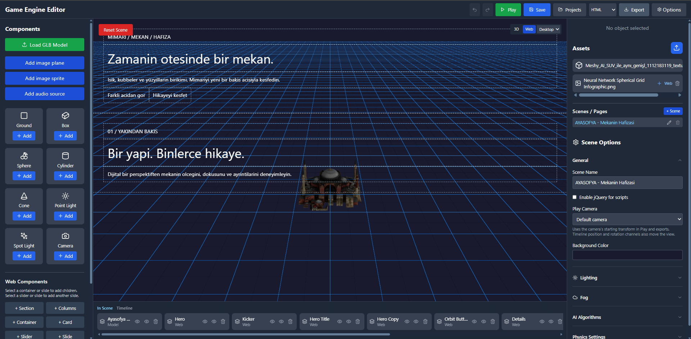
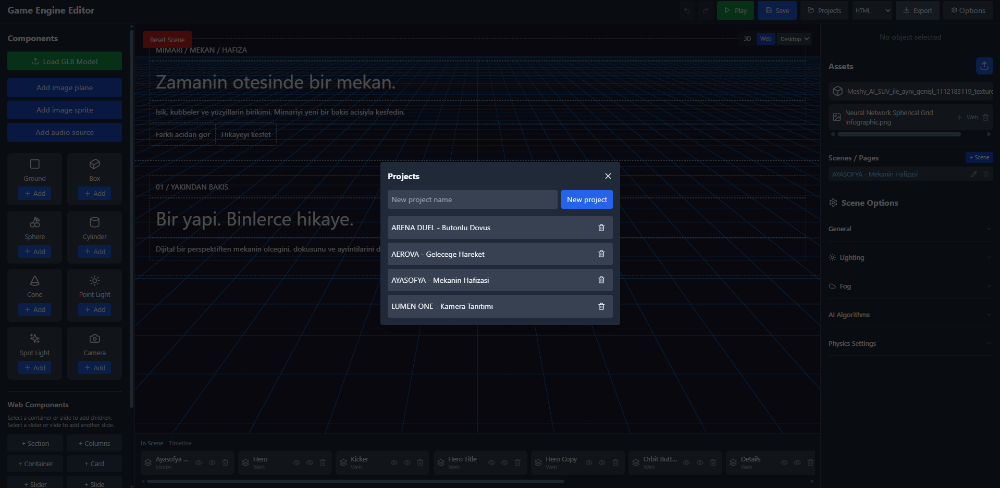
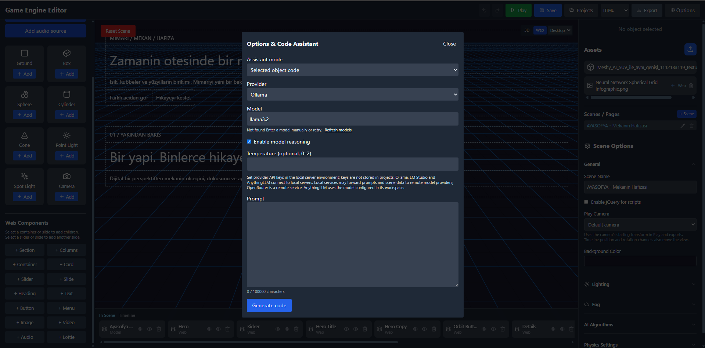
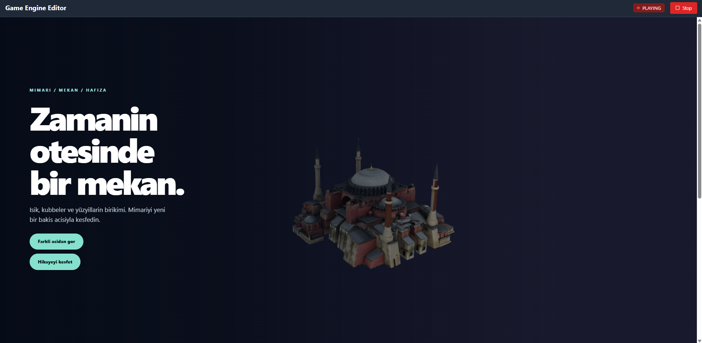
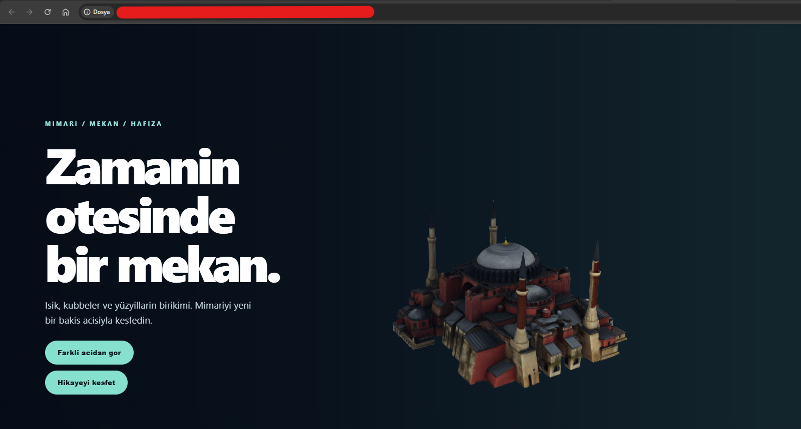
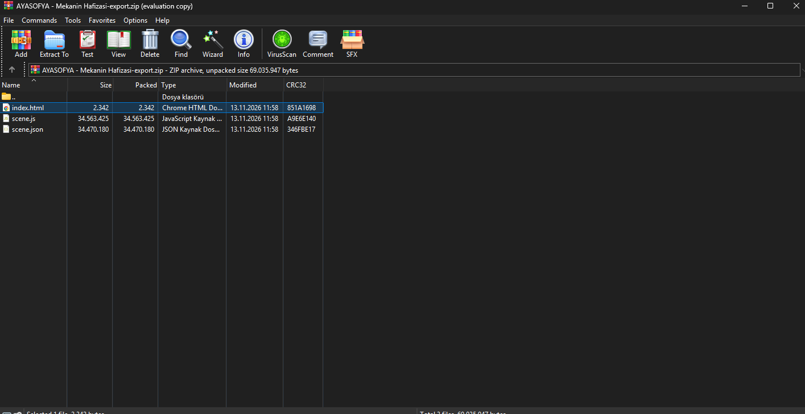

# Game Engine Editor Pre-Free ThreeJS

A browser-based editor for creating interactive 3D scenes, simple games and
web experiences with Three.js, React and TypeScript.

## Screenshots

### Scene editor



### Project management



### Code assistant



### Play preview and HTML export







## Features

- Create multiple scenes, import GLB models and edit objects, materials,
  lighting and cameras.
- Compose web interfaces over 3D scenes and link pages with component actions.
- Animate objects, cameras and web components with a timeline and
  device-specific settings.
- Preview scenes with basic physics, character controls and grid-based AI
  navigation.
- Save projects locally and undo or redo up to 20 project changes.
- Export HTML, a React/Vite wrapper or a WordPress plugin.
- Use a review-based assistant with supported local or cloud AI providers.
- For any missing features, you can also add your own using React + Vite.
- It handles many functions seamlessly. It covers everything needed for basic tasks, website creation, simple games, and animated content. It has some shortcomings.
- It saves a significant amount of time.

See [FEATURES.md](FEATURES.md) for detailed behavior, limitations and setup.
For step-by-step installation and usage in Turkish, see
[HOW_TO_USE.md](HOW_TO_USE.md).

## Desktop application

Run the Windows x64 installer to use the editor in its own window without
installing Node.js. The desktop app stores projects separately from the web
development version and starts a local service on `127.0.0.1:4319`.
On Windows, build the unsigned installer with `npm ci` and
`npm run build:desktop`; it is copied to `Game Engine Editor Setup.exe` in the
project root. The generated installer is excluded from Git.

Linux and macOS packaging is configured with `npm run build:linux` (AppImage
and DEB) and `npm run build:mac` (DMG and ZIP), respectively. Build on the
target OS and architecture. These packages have not yet been built or tested
on their respective platforms; macOS distribution also requires appropriate
Apple signing and notarization.

## Getting started

Requirements: Node.js 22.12 or later and npm, plus a browser with WebGL support.

```bash
npm ci
npm run dev
```

Open the Vite URL printed in the terminal. The command also starts the local
project API on `127.0.0.1:4318`. Stop and restart it after updating server
files. Both the API and development server are intended for local use only;
the API has no authentication and must not be exposed to untrusted networks.

Use **Projects** to create or open a project, **Save** to persist it and
**Play** to preview it. Project snapshots are stored in `data/projects.jsonl`;
history is stored under `data/history`, and working data also uses browser
IndexedDB. The JSONL file is append-only, so deleted and older project
snapshots remain in it. Local data, environment files and separately supplied
3D test assets are excluded from Git.

## Build and test

```bash
npm run lint
npm run build
npx playwright install chromium
npm test
```

`npm run test:integration` and `npm run test:e2e` run the suites separately.
After building the Windows installer, `npm run test:desktop` tests the packaged
desktop app using an isolated data directory.
Browser tests use an isolated temporary project store. The optional VTOL
showcase requires a locally supplied GLB and `VTOL_SHOWCASE=1`; see the test
and [FEATURES.md](FEATURES.md). Some export tests require internet access.

## Export and security

HTML exports contain the generated scene player. React and WordPress exports
embed that player in an iframe rather than producing native components or
blocks. The player loads Three.js and GLTFLoader from public CDNs, so internet
access and an appropriate hosting policy are required.

Scene scripts execute with full browser access. Run only trusted projects and
review generated code. AI requests send prompts and, for scene-agent requests,
scene context to the selected provider after confirmation. Never include
secrets in project data or prompts. Provider credentials belong in the local
server environment, not in source files; see [FEATURES.md](FEATURES.md).

## License

The existing [license summary](license.md) describes proprietary/commercial
terms and refers to a separate formal `LICENSE` file, which is not currently
present. Confirm the applicable terms with the project owner before reuse or
redistribution; the project name alone does not grant an open-source license.
